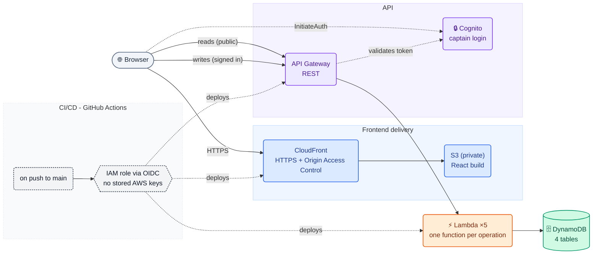

# The Family Rounders Cup

It started with rain. Halfway through the final of our family rounders
tournament, the sky opened, the paper scoresheet turned to mush, and
nobody could agree what the score actually was. We ended up tracking it
on a phone instead. That worked for one match, but a phone isn't a league
table, a match history, or something four different captains can update
from a soggy field next year.

So this is that, done properly. A serverless web app for the tournament:
four teams log in as captains, add players, and submit match results, and
everyone can see a live league table, match history, and tournament
bracket, from a phone, rain or shine.

**It's also my AWS portfolio project.** I'm switching into cloud/AWS work
and wanted to show real hands-on experience, not just a stack of
certificates. And honestly, the problem shape here is a good excuse for
proper cloud architecture: it has to work on a phone, for people who
aren't technical, one day a year, and it can't cost anything the other
364 days. That's basically why it's serverless with on-demand billing
(paying for a server to sit idle all year for one tournament makes no
sense), and why I used Cognito instead of building my own login system
(four captains needing a simple, secure login is exactly what it's for).
Everything's defined as code and deployed through a real CI/CD pipeline,
and I've kept the actual bugs I hit building this in here too, not just
the polished end result.

**Live app:** https://d23lzmogmj156y.cloudfront.net/

  
  
  
  
  

## Skills demonstrated

**AWS:** Lambda · API Gateway · DynamoDB · Cognito · S3 · CloudFront ·
IAM (least privilege, OIDC federation) · CloudFormation · CloudTrail ·
Budgets

**Practices:** infrastructure as code, CI/CD, keyless deployment auth (no
long-lived AWS credentials anywhere), scoped IAM over admin-everywhere,
and root-causing real incidents with real tooling instead of guessing.

**Frontend:** React, TypeScript, Vite, TanStack Query, Tailwind CSS.

## Architecture

Solid lines are what happens when someone uses the app. Dashed lines are
what happens when I push a change and GitHub Actions ships it. It's fully
serverless, so there are no servers to patch and I only pay for what
actually gets used. Everything above is defined as code in
[`cloudformation/template.yaml`](cloudformation/template.yaml).

## Want the details?

- **[docs/ARCHITECTURE.md](docs/ARCHITECTURE.md)**: the full reference.
  Data model, API contract, auth mechanics, security considerations (what's
  enforced and what's deliberately left out), and what I'd do differently
  for a real production deployment.
- **[docs/ENGINEERING-LOG.md](docs/ENGINEERING-LOG.md)**: the actual
  build process, in the order it happened, including three real production
  incidents I hit along the way and how I root-caused and fixed each one.

## What's not built yet

A custom domain (needs a registered domain, so it's on hold), player
statistics beyond a headcount, and a multi-year archive. See
[docs/ARCHITECTURE.md](docs/ARCHITECTURE.md#whats-not-built-yet) for why.
