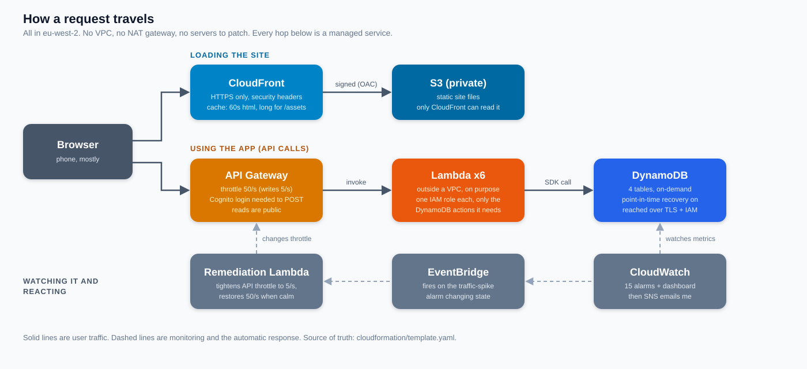

# Networking and content delivery

How traffic gets from someone's phone to the data and back, what I tuned,
and the decision to not use a VPC.

There are two separate paths:

1. **Loading the site.** Browser, CloudFront, private S3 bucket. CloudFront
   signs its requests to S3 (Origin Access Control), and the bucket
   refuses anyone else. All of it is HTTPS only.
2. **Using the app.** Browser, API Gateway, Lambda, DynamoDB. API Gateway
   checks the captain's login token on the three write routes, then
   throttles, then calls the function.

## CloudFront caching

I reviewed this and changed it. Before, one cache policy covered
everything, with a one day default. That's right for the JavaScript and
CSS, but not great for `index.html`.

- **`/assets/*`** (the JS, CSS and fonts): the AWS managed
  `CachingOptimized` policy. Vite puts a hash in every filename, so a file
  never changes under the same name. A day by default, up to a year.
- **Everything else** (`index.html`): a custom policy, `sports-day-short-ttl`,
  with a 60 second default and a 5 minute maximum. The deploy pipeline
  already invalidates the cache on every push, but this means that even if
  an invalidation was ever missed, nobody would see a stale page for more
  than a minute.
- Compression is on (gzip and brotli), HTTP is redirected to HTTPS, and
  AWS's managed security headers policy is attached.
- Price class 100 (Europe and North America only). Cheaper, and it's a
  family event, so I don't need edge locations in Asia.

I did not add a Content-Security-Policy. A bad one breaks the site and I'd
want to test it properly first.

## API throttling

Set on the `prod` stage in the template, not by hand:

| Route | Rate | Burst |
|---|---|---|
| Everything by default | 50 requests/second | 100 |
| `POST /players`, `/teams`, `/matches` | 5 requests/second | 10 |

The write routes get a much lower ceiling because only the four captains
ever use them. "Rate" is the steady flow allowed, "burst" is how many can
arrive at once before it starts saying no (HTTP 429).

On top of that, if traffic goes over about 10 requests a second for 5
minutes, an alarm triggers a Lambda that drops the default to 5 a second,
then restores it when things calm down. See the
[engineering log](ENGINEERING-LOG.md) for how that works.

The limit is for the whole stage, not per person. One noisy visitor can
use up everyone's allowance. Fixing that properly means WAF rate rules or
API keys with usage plans, which I haven't done.

## Why the Lambdas run outside a VPC

This was a deliberate choice, not an oversight.

**The reasoning:**

- The only thing the functions talk to is DynamoDB, and DynamoDB isn't
  inside a VPC to begin with. It's a regional AWS service reached over
  TLS, with every call authenticated by IAM. Putting the Lambda in a VPC
  doesn't make that connection any more private, it just changes the route.
- There's nothing else in the design that needs a private network. No
  database server, no cache, no internal service. The things that make a
  VPC worth it (private subnets for RDS, security groups between
  services) have nothing to protect here.
- Security in this design comes from **IAM, not network location**. Each
  function has its own role that allows only the exact calls it makes (see
  [IAM.md](IAM.md)). That's a stronger control than a subnet.
- Cost. A Lambda in a VPC that needs to reach anything on the internet
  needs a NAT gateway, which is roughly $30 or more a month before any
  data. My whole budget is $5.

**What I give up by not using one:**

- A compromised function could make outbound calls to the internet. In a
  VPC with no NAT, it couldn't.
- No VPC flow logs for the Lambda's traffic.
- No security groups or network ACLs as an extra layer.

I'm fine with that for a four-team family tournament, because the
functions have almost no permissions worth stealing.

**If I did need a VPC:** put the Lambdas in private subnets with a
DynamoDB **gateway endpoint**. That endpoint is free, and it keeps the
traffic to DynamoDB off the public internet with no NAT gateway at all. I
still wouldn't need to pay for NAT. I'd only do this if I was handling
data that justified the extra setup.

## What I'd do differently

- Add WAF with rate-based rules in front of the API, to throttle per
  visitor instead of for everyone.
- Add a tested Content-Security-Policy.
- Put the site on a custom domain with its own certificate (still on hold
  until I have a domain for this project).
